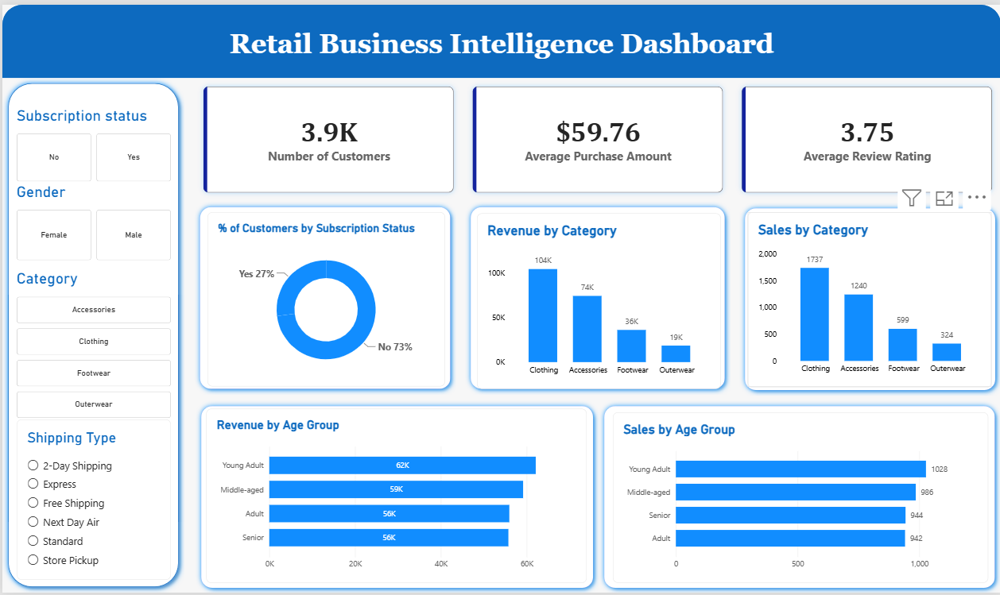

# 🛍️ Retail Business Intelligence Dashboard

A data analysis and business intelligence project that explores customer shopping behavior using Python, Pandas, and Microsoft Power BI.

## 📌 Project Overview

The Retail Business Intelligence Dashboard project focuses on analyzing customer shopping data through data cleaning, preprocessing, and feature engineering.

Python and Pandas are used to prepare the dataset, handle missing values, and create additional features for customer analysis. The processed dataset is saved as a CSV file and is available for use in the Power BI dashboard.

This project demonstrates how raw customer shopping data can be transformed into a structured dataset for business intelligence and data-driven decision-making.

## 📸 Dashboard Preview



The dashboard presents customer metrics, revenue by product category, sales by category, and customer age-group analysis. Interactive filters allow users to explore the data based on customer and shopping characteristics.

Additional screenshots showing dashboard filtering and data preprocessing are available in the [`screenshots`](screenshots/) folder.

## 🎯 Objectives

* Explore customer shopping behavior.
* Clean and preprocess the dataset.
* Identify and handle missing values.
* Standardize column names.
* Create customer age groups.
* Convert purchase frequency into numerical day intervals.
* Prepare a cleaned dataset for further analysis.
* Develop a Power BI dashboard for data visualization.

## 🛠️ Technologies Used

| Technology         | Purpose                                 |
| ------------------ | --------------------------------------- |
| Python             | Data processing and analysis            |
| Pandas             | Data cleaning and manipulation          |
| Jupyter Notebook   | Writing and executing Python code       |
| CSV                | Storing original and processed datasets |
| Microsoft Power BI | Dashboard development and visualization |

## 📂 Project Structure

```text
retail-business-intelligence-dashboard/
│
├── README.md
├── customer_shopping_behavior.csv
├── public customer.csv
├── retail_customer_analysis.ipynb
├── retail_business_intelligence_dashboard.pbix
│
└── screenshots/
    ├── README.md
    ├── dashboard-overview.png
    ├── dashboard-filtered-store-pickup.png
    ├── data-cleaning.png
    ├── age-group-analysis.png
    └── purchase-frequency.png
```

## 📊 Dataset Description

The project uses a customer shopping behavior dataset containing information about customers, purchased products, spending, and shopping preferences.

The dataset includes fields such as:

* Customer ID
* Age and gender
* Item purchased
* Product category
* Purchase amount
* Location
* Product size and color
* Season
* Review rating
* Subscription status
* Shipping type
* Discount and promotional code usage
* Previous purchases
* Payment method
* Purchase frequency

## ⚙️ Data Cleaning and Preprocessing

The Python notebook performs the following operations:

### 1. Data Loading

Loads the customer shopping dataset into a Pandas DataFrame.

### 2. Data Exploration

Uses Pandas functions to inspect the dataset, examine column information, calculate descriptive statistics, and identify missing values.

### 3. Missing-Value Handling

Fills missing review ratings using the median review rating of the corresponding product category.

### 4. Column Name Standardization

Converts column names to lowercase and replaces spaces with underscores to simplify data manipulation.

### 5. Column Renaming

Renames the purchase amount column to `purchase_amount` for easier access.

### 6. Customer Age Group Segmentation

Creates an `age_group` feature using age-based quartile segmentation.

### 7. Purchase-Frequency Transformation

Maps purchase-frequency categories to numerical day intervals and stores the results in a new column named `purchase_frequency_days`.

### 8. Redundant Column Removal

Removes the `promo_code_used` column after comparing it with `discount_applied`.

### 9. Processed Dataset Export

Exports the cleaned and transformed dataset to `public customer.csv` for further analysis and visualization.

## 📈 Power BI Dashboard

The project includes the Power BI Desktop file:

**`retail_business_intelligence_dashboard.pbix`**

Open this file in Microsoft Power BI Desktop to explore the dashboard.

The dashboard includes visualizations for:

* Number of customers
* Average purchase amount
* Average review rating
* Customer subscription status
* Revenue by product category
* Sales by product category
* Revenue by age group
* Sales by age group

Interactive filters allow users to explore customer shopping data using available categories, gender, subscription status, and shipping type.

## 🚀 How to Run the Project

### Prerequisites

* Python 3
* Jupyter Notebook
* Pandas
* Microsoft Power BI Desktop

### Step 1: Clone the Repository

```bash
git clone https://github.com/riyapatel732007/retail-business-intelligence-dashboard.git
```

### Step 2: Open the Project Folder

```bash
cd retail-business-intelligence-dashboard
```

### Step 3: Install the Required Libraries

```bash
pip install pandas jupyter
```

### Step 4: Launch Jupyter Notebook

```bash
jupyter notebook
```

Open `retail_customer_analysis.ipynb` and execute the notebook cells in order.

**Note:** Ensure that the notebook uses the correct CSV file path. If both files are in the same directory, a relative path such as the following can be used:

```python
import pandas as pd

df = pd.read_csv("customer_shopping_behavior.csv")
```

### Step 5: Open the Power BI Dashboard

Open `retail_business_intelligence_dashboard.pbix` using Microsoft Power BI Desktop.

If Power BI requests a data source, select the appropriate CSV file and verify that the data loads correctly.

## 💡 Key Learning Outcomes

* Data exploration using Pandas
* Missing-value handling
* Data cleaning and transformation
* Feature engineering
* Customer segmentation
* Categorical data transformation
* CSV file handling
* Preparing data for business intelligence reporting
* Power BI dashboard development

## 🔮 Future Enhancements

* Add more customer purchasing insights.
* Develop additional business performance indicators.
* Improve dashboard interactivity.
* Explore purchasing trends across product categories.
* Enhance customer segmentation and reporting.

## 👩‍💻 Author

**Riya Patel**

GitHub: [riyapatel732007](https://github.com/riyapatel732007)

---

*This project was developed for educational purposes to demonstrate data preprocessing and business intelligence reporting.*
